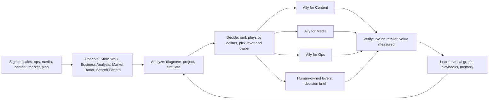

# PRD: Ally Brain, the decision and orchestration layer for ecommerce (vision)

Sep 25, 2026 · Himanshu Jain · Source of truth: https://claude.ai/code/artifact/3f8162b1-9083-4ac2-b536-22fe8eedb94f

## Summary and vision

**Brain decides, agents act, Ally proves it.** Ally Brain is the decision layer that runs a brand's retail business toward plan. It watches everything, decides what matters most, hands the work to worker agents, and shows the dollars it delivered.

This is a vision PRD to anchor prototypes. The Product Box is what we sell today; phasing gets decided later.

- **Brain is the orchestrator.** It analyzes sales, operations, media, content and the market. It finds risks and opportunities: gap to plan so far, projected gap to period end, and market openings. Then it decides what needs to happen to meet or beat the sales goal.
- **Worker agents do the work.** Ally for Content, Ally for Media and Ally for Ops go deep on their lever. They draft the fix, and ship it within the customer's review policy.
- **Everything is opinionated.** Every screen, notification and chat answer leads with what to do and what it's worth. Every answer ends with "here's what I can do next."
- **Two altitudes, one set of numbers.** The exec (core persona) sees the business and makes decisions. The sales analyst sees the work and clears it. The same dollars move on both screens.
- **North star: captured value in dollars.** Value Ally found, shipped or helped the team close, measured against a stated method.

## Problem

Ecommerce teams have more data than ever and still miss plan for reasons they could have caught. The gap between a dashboard and a decision is manual labor, and nobody acts unless something pulls them in.

- **Tools lead with metrics, not decisions.** Customers say today's experience "looks like every other SaaS dashboard." Tiles, tabs and scores, but no answer to "what do I do now?"
- **Diagnosis is manual.** To explain a miss, a manager pulls four reports, checks the promo calendar and opens a competitor's page. The narrative is built by hand, under deadline, before the review.
- **Nobody acts without a push.** Of the 7 accounts where Content Agent was deployed end to end, zero acted on recommendations without prompting.
- **Execs can't see what their team's time is worth.** Value sits in queues nobody opened. Seasonal value expires while it waits for approval.
- **Review effort doesn't match what's at stake.** Analysts approve SKU by SKU, whether it's a hero SKU or a long-tail item, so high-volume work stalls.
- **The market view is missing.** Teams track "dry dog food," but shoppers buy salmon, senior or sensitive-stomach dog food. Nobody can say which micro-segments are growing, where their price pack architecture sits, who they compete with in each, or what strategy wins share back.
- **Trust gates autonomy.** Teams won't let an agent ship alone until they see what it changed, that it worked, and how to undo it.
- **The bar for "always on" just went up.** Amazon's Seller Assistant now runs plain-language standing orders around the clock, can recommend or act, and logs every step. Brain has to meet that bar for vendors, across retailers, with each customer's own context.

## Personas

The exec is the core persona and the sales analyst is the one who does the work. Everything the exec sees must roll up from the analyst's queue, so the two screens always tie.

| | Claire, VP ecommerce (exec, core) | Michelle, sales analyst |
| --- | --- | --- |
| Owns | The sales number; reports to the CEO | Day-to-day business health and the queue of work |
| Unit of work | Portfolio, brand, category, micro-segment | SKU, keyword, PO, campaign |
| Horizon | Month, quarter, trajectory | Today, this week |
| Asks | Where will I land? What closes the gap? Where am I winning or losing share, and to whom? What needs me? | What broke? Why? What do I approve first? What do I send the vendor manager? |
| Relationship to action | Decides, nudges her team, widens autopilot | Approves, gives Ally inputs, escalates, builds the WBR |
| Home surface | Exec home plus a Monday brief | Inbox plus diagnostics |
| Never sees | ASIN IDs, bps, bid values | Vague advice without a parameter |

**Specialist analysts use the same inbox.** A content analyst or media analyst gets the analyst surface filtered to their lever. Their buckets add up to Claire's rows for that lever.

**Where the NAM fits.** The national account manager owns the retailer relationship and is deep in the day to day, but doesn't run reports or analysis. Where a company can't afford a sales analyst, the NAM plays that role. Ally treats that person as the analyst persona, with exec-altitude summaries a click away.

**Supporting roles.** FDEs and CSMs configure business context, playbooks and review policy. They are not a persona for this PRD.

## Product tenets

These ten rules decide every design argument; if a screen breaks one, the screen is wrong.

1. **Action first.** Every output ends in an action: either Ally queues it for a person's approval, or Ally does it as an agent. Even a deck, a dashboard or an answer carries its "so what" as actions that are ready to go. "Here's something I made for you" is never the end.
2. **Always opinionated.** Every answer, workflow and notification ends with the next two to four things Ally can do. Never a dead end.
3. **Push beats pull.** What's broken or important reaches the person in Teams or email. The app is where they act, not where they discover.
4. **Money is the sort order.** Rank by dollars at risk or dollars to gain, not by recency or count.
5. **Numbers tie everywhere.** One semantic layer. The analyst's buckets sum to the exec's rows. A number that doesn't reconcile isn't shown.
6. **Prove value.** Projected vs delivered, the method, and the reason for any gap.
7. **Say what you don't know.** Show what was ruled out, what couldn't be checked, and ranges instead of false precision.
8. **Trust earns autonomy.** Review effort follows what's at stake. Autopilot grows as the product proves itself.
9. **Context is the moat.** Each customer's rules, calendars and conventions shape every answer. Generic advice is a bug.
10. **Configuration lives in the background.** Settings sit behind a gear. Chat can change them in plain language.

## How it works: the Brain loop

Brain runs one loop for every customer, continuously: **Observe, Analyze, Decide, Act, Verify, Learn.** Analysis agents inside Brain find and size the work; worker agents outside it execute; results flow back to sharpen the next decision.

| Stage | What Brain does | Built on |
| --- | --- | --- |
| Observe | Crawls the digital shelf up to 12 times a day, reads sales, inventory, ads, share and search data, watches competitors | Store Walk, Alerts, market share and market insights data |
| Analyze | Explains why a number moved, where it lands if nothing changes, and what happens if we act | RCA engine: Diagnose, Project, Simulate |
| Decide | Turns findings into plays, sizes each in dollars, assigns a lever and an owner, applies the review policy | Driver-to-lever map, SKU tiers, playbooks |
| Act | Hands each play to a worker agent, or drafts a decision brief when no agent owns the lever | Ally for Content, Media, Ops |
| Verify | Confirms the change is live and measures delivered vs projected value | Store Walk re-crawl, value measurement methods |
| Learn | Feeds outcomes and edits back so the next play is sharper | Causal graph, episodic memory, playbooks (skill files), OPIK traces |

**Analysis agents inside Brain.**

- **Store Walk.** Ranked digital shelf issues on the customer's SKUs, several crawls a day.
- **Business Analysis.** Gap to plan, projected gap, and period-over-period movement down to SKU.
- **Market and Competition Radar.** Share by category and micro-segment, competitor price, promo, SOV, launches and content changes.
- **Search Pattern.** Emerging queries, search frequency rank shifts, keyword whitespace.

**The play: Brain's handoff to a worker agent.** Every play carries the opportunity, the cause, the value range, the deadline, the SKU scope and tiers, the recommended action, and the evidence. The worker returns a draft with projected value, and Brain tracks it through to delivered.

## Core concepts

Three ideas carry the whole product: every open dollar sits in one bucket, review effort follows the SKU's tier, and every closed dollar is counted as captured value.

### Open value buckets

Every open play sits in exactly one bucket, per lever, ordered by the effort it needs.

| Bucket | Meaning | Effort |
| --- | --- | --- |
| On autopilot | Ally is authorized; ships on its go-live date whether or not anyone opens the app | None |
| One approval away | Ally drafted the work; a person approves it | Minutes |
| Needs your team | Ally is blocked on a decision, an input or a lever it doesn't own | Days |

Value that misses its window moves to **Expired** and stays visible, because it's the cost of the status quo.

### SKU tiers and the review policy

SKUs are tiered by share of sales, and the tier sets the default review mode.

| Tier | Definition | Default review |
| --- | --- | --- |
| Hero | SKUs making up the top 50% of sales | Always requires approval, one by one |
| Core | The next 40% of sales | Approve in bulk |
| Tail | The last 10% of sales | Autopilot, with a scheduled go-live date |

- **Rules sit on top of tiers.** A rule scopes by retailer, brand, SKU group, tier, lever or field, such as "title changes always need review." The most specific rule wins, and a field rule can only add review, never loosen it.
- **Hold back.** Any autopilot batch can be sampled and pulled into review before it ships.
- **Earn autopilot.** After a person approves several batches of a type with no edits, Ally suggests moving that type to autopilot, once.
- **Everyone sees who set what.** Execs and analysts can both change the policy, and each rule shows who set it and when.

### Captured value, the north star

Captured value is the dollars Ally found that turned into sales, split by who closed it.

| Bucket | What it is |
| --- | --- |
| Agents did it themselves | Worker agents shipped it on approval or autopilot |
| Agents found it, the team closed it | Ally detected and prepared it; a person or the retailer fixed it |
| Found, not closed | Stalled or expired |
| Waiting on approval | Drafted and modeled, not yet realized |
| Unworked | Found, never picked up or rejected |

**Realization rate** is closed value over found value. It measures the team's follow-through, not Ally's detection.

Every result shows projected, delivered, the method and the reason for any gap. Methods by type of work:

| Method | Used for |
| --- | --- |
| vs category | Seasonal content and events: SKU growth against category demand, adjusted for price, ads and stock |
| A/B tested | Foundational content: traffic split where possible |
| Leakage prevented | Ops fixes: normal daily sales times the days sooner it was fixed |
| Pre/post, seasonality adjusted | Media changes |
| Matched control | Content and media where A/B isn't possible |

## What Brain watches: the signal library

Brain watches about 30 signals across eight domains and sizes each in dollars; most are already specified in the Alerts PRD and live in Store Walk. A signal is never shown alone: it arrives with its cause, its value and a prepared next step.

| Domain | Signals | Default next step | Worker |
| --- | --- | --- | --- |
| Availability and supply | Out of stock (national, regional), low DC stock and weeks of cover, predicted OOS, PO discrepancy and fill rate | Draft PO expedite email to vendor manager, re-forecast, redirect inventory | Ops |
| Buy box and price | Lost buy box, 3P seller incursion, MAP violation, competitor price cut, CRaP risk | Draft vendor manager escalation, MAP enforcement note, pricing decision brief | Ops, human |
| Promotions | Promo badge missing, deal badge missing, deal page visibility, coupon detected or unintended coupon | Draft vendor manager email with crawl evidence, fix coupon setup | Ops |
| Traffic and media | Keyword rank drop, competitor conquesting branded terms, share of voice drop, low spend on high-value keywords, media spend anomaly, budget pacing | Bid or budget change, branded defense, reallocation | Media |
| Conversion and content | Sudden conversion drop, traffic stable but units down, content benchmark gap, content changed or non-compliant, rating drop and negative review spike, BSR change | Content fix or rewrite, PDP audit, quality investigation brief | Content |
| Fulfillment | Shipping speed and Prime eligibility by location | Ops escalation | Ops |
| Market and competition | Share shift by category and micro-segment, competitor launch, competitor promo or media push, competitor content update, emerging search term, fast-growing segment where we're under-indexed | Media and content plays, competitive strategy brief, NPI brief | Media, Content, human |
| Plan | Gap to plan, projected gap at period end, pacing risk by brand, category, SKU | Closing plan: ranked plays across levers | Brain |

### "Tell me now": critical signals

Most signals roll into the daily brief. A signal becomes a **critical push** to Teams, Slack or email the moment it's found when any of these are true:

- A **hero SKU** goes out of stock, loses the buy box, or gets suppressed.
- **Revenue at risk** crosses the customer's threshold per day.
- The **projected gap** at period end crosses the customer's threshold, or gets worse by more than the threshold week over week.
- A competitor **takes position on branded terms** of a hero SKU.
- **Seasonal value** is about to expire before its live-by date.
- A **worker agent needs approval** on a hero SKU with a deadline inside 48 hours.

Customers can add their own critical rules in plain language through chat.

## Workflows: precomputed and shown as chips

Six workflows are precomputed for every customer and appear as chips on each home screen and in chat. People don't start from a blank prompt: they tap a chip, get an opinionated answer, and tweak it through chat ("split this by brand," "only hero SKUs," "compare to last Prime Day").

| Chip | Claire asks | Michelle asks | What Brain produces | Typical next actions |
| --- | --- | --- | --- | --- |
| Today's brief | What needs me today? | What broke overnight? | Ranked issues and plays with dollars and owners | Approve, assign, nudge, draft vendor email |
| Gap to plan | Where will I land and what closes it? | Which brands, categories and SKUs are behind, and why? | Actual and projected vs plan, the bridge, drivers, closing plays | Send plays to agents, set a pacing alert, make it the WBR |
| Market and competition | Where am I winning or losing share, and to whom? | Which competitor moved, on which terms and SKUs? | Share by micro-segment, price pack map, competitor moves, whitespace, a strategy | Launch media or content plays, schedule the competition report, draft NPI brief |
| Captured value | What did Ally and my team deliver? | What's stuck in my queue? | Found, shipped, closed, waiting, expired, by lever and owner | Increase autopilot, nudge owners, export for QBR |
| Reports | Give me the WBR and QBR | Build this week's WBR | Scheduled WBR, QBR, competition and search pattern reports as decks or PDFs | Edit the storyline, send to team, schedule |
| Event readiness | Are we ready for Prime Day? | What broke last Prime Day and is it fixed? | Readiness by SKU, last year's replay, expected lift and risks | Pre-approve plays, lock deal setup, schedule content |

### Gap to plan, looking back and forward

Gap to plan answers two questions at once: how far behind are we so far, and where will we land if nothing changes?

- **Plan in, at any grain.** Customers upload plan at SKU, category or brand level, by week, month or quarter. A higher-level plan is phased down to lower levels so every SKU and week has a target.
- **Actual vs plan.** Last week, month to date and quarter to date, always shown with plan and actual beside the gap so a $10M gap on $100M reads differently from $10M on $20M.
- **Projected landing.** Run rate plus the drivers still doing damage, shown as a range, never a single midpoint. If too much of the movement is unexplained, Brain says so instead of projecting.
- **The bridge.** A waterfall from projected landing through On autopilot, One approval away and Needs your team, up to total opportunity, against the plan line.
- **Drivers and plays.** The top causes by dollar, classified as structural, transient, seasonal, self-inflicted or competitive, each mapped to a play and an owner.
- **Opportunities, not just risks.** Segments, SKUs and terms where Ally sees upside beyond plan.

### Market and competition

The market view shows how the brand stacks up in each micro-segment it plays in and what strategy wins share.

- **Micro-segments, built from how shoppers search.** Search term clusters define the segment ("senior dog food," "salmon dog food," "sensitive stomach dog food"). PDP attributes classify every own and competitor SKU into those segments: benefit, form, life stage, flavor, ingredient and pack size.
- **Size, growth and share per segment.** Where the segment is growing, where the brand is under-indexed, and which segments have no brand product at all (whitespace).
- **Price pack architecture.** Price per unit against pack size for the brand and competitors in each segment, showing gaps and crowded price points.
- **Who the competition is.** Competitors set per SKU, segment and category from co-listing in search results, sponsored slots and share, with customer overrides.
- **How we stack up.** Share, price index, SOV, rating, content score and availability vs each key competitor.
- **Competitor moves.** Promotions, price cuts, launches, media pushes and content changes, with the likely effect on our share.
- **Competitive strategy.** A recommended response per segment: defend, attack, reposition or exit, with plays routed to Media, Content and humans (pricing, NPI).

## Interaction model: opinionated chat

Chat is how people interact with everything, but it's never the only surface and never a blank box. Pushes, chips and cards are the entry points; chat is where people go deeper, change a workflow, or act.

### The answer contract

Every answer, whether from a question, a chip or a card, follows the same shape:

1. **Verdict first.** One sentence: what happened, how much, the main cause.
2. **Why and what it's worth.** Ranked causes with dollars, plus what was ruled out.
3. **Where it lands if we do nothing.** When the cause is still live.
4. **Here's what I can do next.** Two to four contextual actions, as buttons, ranked by value. At least one is already prepared (a drafted email, a queued play, a scheduled send), so a single tap sets it in motion.
5. **Trust layer.** Every number tappable (definition, source, freshness), a confidence level with its reason, named blind spots.

The altitude changes by persona and the numbers never do. Claire gets about 120 words ending in a decision; Michelle gets the full breakdown ending in a step with a parameter.

### Next actions Ally can offer

| Type | Examples |
| --- | --- |
| Hand off to an agent | "Send these 11 SKUs to Ally for Content," "Have Ally for Media defend these 5 branded terms" |
| Draft for a person | "Draft an email to your vendor manager with crawl evidence," "Write a pricing decision brief" |
| Go deeper | "Break this down by micro-segment," "Compare to last Prime Day," "Show which 3P sellers" |
| Keep watching | "Alert me if this SKU drops below 4 stars," "Tell me Monday if the gap widens" |
| Share | "Turn this into this week's WBR slides," "Email this summary to my team," "Nudge Mike" |
| Save | "Pin this as a dashboard," "Make this a chip for my team" |
| Change the rules | "Put core seasonal content on autopilot," "Never use 'Made in USA' in Yankee Candle titles" |

### Examples

| Someone asks | Ally leads with | Ally offers next |
| --- | --- | --- |
| Claire: "Why are we behind this quarter?" | "You're tracking to $48M, $4M short of plan. 60% of the gap is two hero SKUs out of stock and lost buy box on 34 SKUs." | Approve the ops plays ($3.2M), nudge Michelle, see the bridge, make it the QBR slide |
| Michelle: "How did air fryers do in Aug vs July?" | "Air fryers grew 14%. Traffic rose on two SKUs: one ran a promo and one came back in stock." | Check the promo badge on the rest, extend the promo brief, pin as a dashboard |
| Claire: "Who's taking share in senior dog food?" | "Competitor X gained 3.1 share points with a 20% price cut and 7 of 12 sponsored slots." | Launch the branded defense play, draft the pricing brief, schedule the weekly competition report |

### Standing orders

People can give Ally plain-language instructions that run in the background, such as "If any hero SKU loses the buy box for more than 6 hours, draft the vendor manager email and ping me in Teams." Each standing order shows its scope, its trigger, whether it recommends or acts, and its audit trail.

### Chat builds everything else

Dashboards and decks come from conversations. Someone explores in chat, then says "make this a dashboard" or "turn this thread into slides." Chat opened from a widget, alert card or report carries that context with it, so nobody re-types what's on screen.

## Chat as a surface

Chat is one engine with one history that shows up in three places. Ally does the work up front (surfacing issues, alerts and metrics), and chat is where people double-click, change things and act.

| Where | How people get there | Best for |
| --- | --- | --- |
| Full-page Ally | Top-level nav item, always available | Long work: decks, deep dives, skills, dashboards, CS work |
| Contextual panel | From any card, alert, widget or workflow | Quick drill-downs without leaving the page |
| Pushed threads | Replying to a Teams, Slack or email notification | Acting on what Ally pushed |

- **Full-page Ally is a top-level nav item.** It looks and feels like Claude or ChatGPT, because people already know that pattern. It never opens on a blank box: it opens on today's brief, the workflow chips, recent threads and saved objects. When the work produces something, the page splits: conversation on the left, the object being built on the right.
- **The panel expands to full page** with the thread intact.
- **Threads work like Claude.** A thread list on the left, searchable. Coming into chat from another area always starts a new thread carrying that area's context. Within a thread, people keep going or start a new one.

### Ally already knows you, so it starts with a draft

Ally knows the person's role, their brands, their calendar, last week's numbers and what they've asked before. So the default is that **Ally drafts first and the person edits**, rather than starting from nothing.

- "I'm meeting my boss Monday morning" returns a ready deck in seconds: where the quarter lands, the gap, what's closing it, and the one decision needed. Then **Customize**, **Storyboard it** or **Start from scratch**.
- Before a recurring meeting on the calendar, Ally offers the prep unprompted ("Your WBR is at 10. Here's the draft.").
- **Starting from scratch is always one tap away.** It opens the storyboard empty, with Ally suggesting the questions to answer.

### Everything chat creates gets a home

Chat is where things are made; each object then lives in its home and stays linked to the thread that made it.

| Object | Home | Example |
| --- | --- | --- |
| Custom alert | Alerts page and notifications; can be pinned to the exec home | "Alert me when any top-20 SKU falls more than 10% week over week" |
| Dashboard | Dashboards | Several analyses saved together as "Promo health" |
| Deck | Reports, with save as template | Prime Day retro |
| Knowledge entry | Knowledge base | "We're sponsoring the Oct 18 event; 3 new SKUs launch with it" |
| Skill | Skills library, runnable from chat or a chip | Vendor negotiation prep |
| Play for a worker agent | The analyst inbox, for approval | Five hero images queued for Ally for Content |

### Every object ends in action

Nothing chat creates is a dead end. Each object arrives with the actions it implies, either queued for approval or done by Ally.

| Ally creates | The so what | Queued for you | Ally does it |
| --- | --- | --- | --- |
| QBR or WBR deck | The closing plays and decisions the deck argues for | Approve the plays in the deck, assign owners | Sends the deck to attendees, schedules follow-ups, nudges owners after the meeting |
| Answer to a question | The fix for the cause it found | Approve the play, send the drafted vendor email | Hands the play to a worker agent within the review policy |
| Dashboard | What changed since last view and what to do about it | Plays for the widgets that moved | Watches it and alerts when it moves |
| Custom alert | The response when it fires | A prepared fix in each alert | Runs the fix on autopilot for tail SKUs |
| Skill run (vendor negotiation prep) | The asks and walk-away points | A drafted negotiation brief and email | Pulls the latest data before every meeting |
| Knowledge entry (event sponsorship) | The work the news creates | Creative and content plays for the new SKUs | Queues content for Ally for Content |

The last slide of every deck is a live action slide: each recommendation in it is a real play with an owner, a value and a button, and approving it in the deck is the same as approving it in the inbox.

## Chat use cases

Eight use cases define what chat must do well; each one ends in something saved or something acted on.

**1. Drill into an issue.** From gap to plan, Michelle taps the category that's furthest behind, then its top SKU, then the driver. Or she types "in-stock rates are dropping in pet food, why?" Ally runs the root cause, shows what was ruled out, and offers the fix.

**2. Turn an answer into a custom alert.** "Show me the top 20 SKUs that declined in sales" returns the list. Then: "Alert me every time any of my top 20 SKUs falls more than 10%." Ally confirms the scope, threshold, channel (Teams, Slack, email or the alerts page) and owner. Everyone creates their own alerts. Execs rarely use the alerts page, but can pin any alert to their home.

**3. Save analyses as a dashboard.** After four or five questions about promo performance, Michelle says "save these as a dashboard called Promo health." Each answer becomes a widget, still live and still connected to chat.

**4. Instant deck.** "Show me a deck for my Monday meeting with my boss" returns a finished deck built from what Ally already knows, then offers Customize, Storyboard it or Start from scratch.

**5. Storyboard a deep dive.** "I need a retro of last Prime Day" or "help me plan Black Friday." Ally proposes the questions the story should answer and the chart for each. The storyboard is a grid of boxes inside Ally, one per slide, with three views:

| View | Shows |
| --- | --- |
| Outline | Slide titles only, reorderable |
| Questions | The question and analysis behind each slide |
| Storyboard | Each box with its title, chart sketch and key takeaway |

People edit in plain language ("merge 3 and 4," "add a slide on competitor promos"), then generate. Export uses the customer's branded PowerPoint template. Any storyboard can be saved as a reusable template.

**6. A worker agent joins the work.** Mid-analysis, Ally spots something a worker agent can act on, such as a search trend competitors are tuning their content toward. Ally says what it will do ("I'll draft content changes for these 11 SKUs for your approval") and the work lands in the inbox. One voice throughout: Ally is on it, with a line saying which agent did the work.

**7. Bring Ally new information.** Michelle pastes an email from the brand team: they're sponsoring an event and launching three new SKUs with it, plus concepts from the creative agency. Ally proposes saving the facts to knowledge with **Yes**, **No** or **Just for me**. Then it turns the concepts into five hero images per SKU, checked against retailer rules (file size under the limit, required dimensions, background, no unverified claims), and queues them for Ally for Content. The approval shows the side-by-side page preview.

**8. Create a skill from past work.** "I'm going into a vendor negotiation, help me." Ally asks what vendor negotiation means for this team. Michelle uploads the analysis her analyst took two months to build last year. Ally extracts the steps, the data it needs and the outputs, and turns them into a skill. It asks for anything it can't find, such as manufacturing cost, as an upload. Next time, "open my negotiation prep" runs the whole sequence. Anyone can create a skill; it's personal until shared with the team or account.

## Teaching Ally and the feedback loop

Every correction becomes something Ally reuses, and the product shows what it learned. One store holds all of it, so teaching chat and tuning Content Agent are the same mechanism.

### How people teach

- **Thumbs up and thumbs down only.** Thumbs down opens "What did I miss?" with quick picks (wrong number, missed something, wrong logic, wrong format) and a text box. Thumbs up can optionally save the answer as "the right way."
- **Correct the recipe.** For a chat answer, the person fixes the logic (steps, metrics) or the presentation (columns, sort, labels) separately. Ally reruns, shows before and after, and saves only once confirmed.
- **Plain language.** "Remember that Hill's measures plan by weight" works anywhere.
- **Content review captures itself.** An edit before approval is saved as a correction with a reason chip. A rejection is a negative example. "Use as example" saves a great draft. FDEs and CS can seed the library with the brand's best pages on day one.
- **Outcome annotations.** On results, "this SKU ran a promo that week" corrects how value was measured.

### What Ally does with it

| Kind | Example | How Ally uses it |
| --- | --- | --- |
| Rule | "Never use 'Made in USA'" | Always enforced |
| Recipe | The steps and columns for "How is Coca-Cola doing at Target?" | Replayed on a near-exact match; used as an example on a close match |
| Example | An approved title for senior dog food | Retrieved by account, brand and category as a few-shot example |
| Annotation | Promo week on a SKU | Feeds value measurement |

Account rules in the playbook always win over any example, and examples never cross accounts.

### Who can teach

Settings has a **Who can teach Ally** list. Lessons from people on it apply at their chosen scope (me, team, account). Lessons from anyone else apply to them personally and go to the list as suggestions. Ally always confirms what it learned ("Learned: Hill's gap to plan is by weight. Applies to your account."), and every lesson can be edited or undone in the knowledge base.

### The loop, made visible

Correction, then stored, then retrieved next time, then measured. Every thumbs down becomes a permanent test case, and playbook or example changes ship only after the eval suite passes. The exec home shows it in one line: "Ally learned 14 things this month; your team's edits on drafts fell 40%."

## CS workbench, through chat

The CS workbench is not a separate product: it's full-page Ally, used by a CSM on one account at a time, with CS skills preloaded. Today CS teams do this work outside the product, in spreadsheets and decks; the workbench pulls it in.

| CS job | How it runs in chat |
| --- | --- |
| WBR, MBR, QBR | Instant deck from the account's numbers, then storyboard and export in the customer's branded template; can be scheduled |
| Value pitch | Built from the captured value ledger: what Ally found, shipped and delivered, with methods, ready for a renewal or expansion conversation |
| Ad hoc analysis | Ask, refine, save as a dashboard or deck |
| Audit of what agents did | "What did Ally change for this account last month?" returns every action with before and after, who approved it or which rule allowed it, and the result; exportable |
| Agent tuning | Curate the account's examples and rules, seed the content example library, review suggested lessons |

- **One account at a time.** No cross-account portfolio view.
- **Same objects, same homes.** What a CSM builds (decks, dashboards, skills, alerts) lands in the account's homes, where the customer can see and reuse it.

## Templates shared across customers

Yes, with one rule: CommerceIQ publishes templates to every customer, and a customer's own work never crosses to another customer. A template carries structure, never data.

| Template type | Examples |
| --- | --- |
| Storyboards | Prime Day retro, Black Friday plan, promo deep dive, QBR, competitive review |
| Skills | Vendor negotiation prep, new product launch readiness, out-of-stock recovery |
| Alert recipes | Top-SKU decline, hero buy box loss, branded term conquesting |
| Dashboards | Promo health, gap to plan by category, micro-segment share |

- **Templates come alive in the account.** When someone uses one, it picks up their data, playbook, knowledge and branded export template.
- **Customers save their own.** A storyboard or skill saved by a customer is a template for their account only.
- **Graduation.** When CS sees the same pattern working at three or more customers, CommerceIQ rebuilds it as a generic template, with no customer data or wording, and publishes it to everyone. This follows the FDE platform rule of promoting what three or more clients need.
- **Templates are opinionated starting points.** Ally suggests the right one ("Prime Day is in 5 weeks; start from the readiness storyboard?"), so people rarely browse a gallery.

## Build order for chat, teaching and the workbench

All of it ships; the order follows what's already live (chat on 8 alert clients, RCA, alerts, Content Agent) and makes each step pay for the next.

| Order | Theme | What ships | Why this order |
| --- | --- | --- | --- |
| First | Answer and act | Full-page Ally and the contextual panel, threads, the answer contract with next actions, drill-down from issues, custom alerts from answers, save as dashboard, thumbs up and down with "What did I miss?", "Ally is on it" handoff to Content | Turns today's chat into an opinionated one and creates the objects everything else builds on |
| Second | Build the story | Instant deck, storyboard (outline, questions, storyboard views), branded PowerPoint export, save as template, meeting prep from the calendar, knowledge capture with Yes / No / Just for me, side-by-side page preview, creative asset adaptation | Biggest time saver for execs and CS, and the clearest demo |
| Third | Teach and scale | Skills from uploaded work, Who can teach Ally, correct-the-recipe, content example library and tuning, CS skills (value pitch, audit), CommerceIQ template gallery, standing orders | Needs the stores and evals from the first two to be safe |

Design follows the same order: full-page Ally and the answer contract get designed first in Claude Design, then the storyboard, then teaching and skills.

## Surfaces

The product replaces dashboards with a briefing, an inbox and pushes. Six surfaces cover everything, and a shared period switch (week, month, quarter, year) drives all of them.

### Exec home (Claire)

The exec home answers "where do I land, what closes the gap, and what needs me" in under a minute.

1. **Hero sentence in business terms.** "You're tracking to $48M this quarter. That's $4M short of your $52M plan. We have $6.8M in the pipeline to close it: $3.2M ops, $2.1M media, $1.5M content. 45 minutes of your team's time unlocks $3.6M; $660K expires in 18 days."
2. **Bridge to plan.** The waterfall from projected landing through the three buckets to total opportunity. Each stage opens to owner, what's waiting, status this week and value, with **Nudge** for owners who haven't started and **Increase autopilot** on autopilot rows.
3. **Market pulse.** Share gaining or losing by category and micro-segment, the one competitor move that matters most, and the strategy Ally recommends.
4. **What needs you.** One or two decisions only the exec can make, such as a pricing response or an NPI brief, framed as a trade-off to approve.
5. **Captured value this quarter.** Projected vs delivered per lever, with plain bullets on what worked, what's waiting and what Ally learned.
6. **Reports ready.** Latest WBR, QBR and competition report, each with a one-line summary.
7. **Chips and Ask Ally.** The six workflow chips, plus a chat bar with exec-altitude seed questions.

Top bar: period switch, **Email** (the page as a PDF, all sections expanded), **Notifications**, **Settings**.

### Analyst home (Michelle)

The analyst home clears the week's highest-value work in minutes.

- **Hero line.** "$3.2M of ops opportunity is open this quarter. $1.1M is one approval from live. You're losing $42K a day right now."
- **Inbox grouped by bucket.** On autopilot, One approval away, Needs your team. Each group shows value and effort, and each item is cut by the review policy so it has one action (for example, "Lost buy box · Hero · 4 SKUs · +$180K · review each").
- **Detail pane that builds trust, then acts.** What Ally found and changed, one real sample SKU before and after, the evidence (crawl snapshot, 7-day trend, diagnosis), the reassurance line on bulk items, then the action.
- **Ops items come with the email.** A drafted vendor manager email, or a Vendor Central case, with the evidence attached, ready to send.
- **Diagnostics.** Gap to plan and root cause already computed and open on every SKU, category and brand, not behind a click.
- **Chips and Ask Ally**, with analyst-altitude seed questions grouped by Store Walk, gap to plan and period over period.

### Notifications service

One notification service serves all of Ally (Brain, Content, Media, Ops), so a person never gets two versions of the same alert.

| Type | When | Channel | Example |
| --- | --- | --- | --- |
| Critical | The moment a critical signal fires | Teams, Slack and email | "Hero SKU B08X out of stock since 6 AM. Losing $18K a day. Draft to vendor manager is ready." |
| Daily brief | Every morning | Email, Teams digest | Top five plays by dollar, what shipped yesterday |
| Weekly | Monday 8 AM | Email to the team | Each owner's queue with value and deadline |
| Nudge | When the exec nudges | Teams DM | "Claire nudged you: $660K of Halloween content expires in 18 days" |
| Report ready | On schedule | Email | "Your WBR is ready: $1.2M behind plan, 3 plays to close it" |

Every notification leads with dollars, links straight to the action, and where possible lets people act inline (approve, assign, snooze). Routing follows ownership, with frequency caps and quiet hours per person.

### Dashboards (free enablement)

Dashboards are the "show me the numbers" layer, included at no extra cost, never the home screen. They build on the Omni Dashboard and Insights work: configurable widgets, widget insights and an executive summary on top, every number traceable to its cell, business context applied, and Ask Ally on every widget and dashboard. Anything built in chat can be pinned as a dashboard.

### Settings (gear on every page)

- **Review policy:** tier defaults and rules, with a preview ("Saving puts 394 more SKUs, +$305K, on autopilot").
- **Knowledge:** writing and business rules per scope ("Don't use 'Made in USA'; 'Originates in USA' is fine").
- **Plan:** upload and phasing.
- **Signals and notifications:** subscriptions, critical thresholds, channels, standing orders.
- **Market:** competitor set and micro-segment names, with overrides.

### Results (the engine room)

SKU-level proof of every dollar, by measurement method, with what changed, who or what shipped it (analyst or autopilot, and which rule), whether it worked, and undo.

## Worker agents and their actions

Three worker agents execute Brain's plays, one per lever, and a decision brief covers levers no agent owns. All follow the same review policy, log every action, and hand results back to Brain for verification.

| Agent | What it does | Example actions | How it ships |
| --- | --- | --- | --- |
| Ally for Content | Compliance, SEO, AEO (Rufus and other retailer assistants), creative adaptation | Rewrite titles and bullets for emerging query language, fix PIM-to-page mismatches, repair A+ modules, seasonal images | PIM, Procat, SP-API, or portal automation for long-tail retailers |
| Ally for Media | Bids, budgets, allocation, keyword strategy | Defend branded terms under conquesting, fund high-value keywords with no spend, reallocate from branded to generic, dayparting, event pacing | Amazon Ads API |
| Ally for Ops | Availability, buy box, promotions, fulfillment, listings | Draft vendor manager emails for OOS, lost buy box, missing promo or deal badge and shipping speed; open Vendor Central cases; flag MAP violations with seller evidence; check coupon setup | Email and Teams to the vendor manager, Vendor Central cases |
| Human-owned levers | Pricing, new product introduction, trade spend | Decision brief with the options, value of each, and do nothing as a named option; drafted internal email | Routed to the named owner |

**Ops is core, not an add-on.** Most of today's value sits in ops: lost buy box, out of stock and missing badges. For these the "action" is a prepared escalation with evidence, which is what gets them fixed in hours instead of weeks.

**Rules every agent follows.**

- Hero SKUs always need approval; core SKUs can be approved in bulk; tail SKUs ship on autopilot; customer rules sit on top.
- Every action shows before and after, who approved it or which rule allowed it, and how to undo it where the retailer allows.
- Store Walk confirms each change is live within 48 hours, then value measurement starts.
- An agent never invents what it can't know, such as creative concepts or pricing authority. It moves the play to Needs your team and asks.
- Profit recovery automations (shortages, chargebacks, price variance) can plug in as further worker capabilities under the same loop.

### Side-by-side page preview

Agency partners asked to see the old product page next to the new one before and after any change, especially images, A+ and other creative. Every content approval shows the whole page, not just the changed fields.

| When | Left | Right | What it's for |
| --- | --- | --- | --- |
| Before approval | The live page from the latest crawl | The same page rebuilt with the draft swapped in, labeled Preview | Judge the creative in context before it ships |
| After go-live | Snapshot from before the change | Fresh crawl of the live page | Proof it went live correctly; value measurement starts |

- **Whole page:** image gallery, title, bullets and A+ modules in order, with changed areas outlined and a "show only changes" toggle.
- **Desktop and mobile toggle**, since most shoppers see the mobile page and A+ stacks differently there.
- **Search tile view:** the new main image in the search results grid next to competitors' tiles.
- **Retailer checks on the asset:** file size, dimensions, background and claims, each passed or failed.

## End-to-end scenarios for prototypes

Seven scenarios cover the vision end to end; each should be clickable in the prototype with the same demo numbers (Q4 FY26, $48M tracking vs $52M plan, $6.8M pipeline).

**A. Tell me now (exec, ops).** At 6:10 AM Claire gets a Teams message: a hero air fryer is out of stock nationally, losing $18K a day, with a PO arriving in 12 days. The card offers "Send the drafted expedite email to the vendor manager" and "See other SKUs at risk." Michelle approves the email; Claire's bridge moves $250K from Needs your team to One approval away.

**B. Monday gap to plan (exec to analyst).** Claire opens the Gap to plan chip. Ally leads with the landing range, the $4M gap and the bridge. Content has $660K one approval away and Mike hasn't started. Claire taps Nudge, Mike gets a Teams DM, approves core in bulk and reviews 12 hero SKUs one by one. Claire's row flips to "All approved" and the value moves toward the run rate.

**C. Market and competition (exec).** Claire taps the Market chip. In premium dry dog food, the "senior, sensitive stomach" micro-segment grew 22% while the brand holds 4% share; Competitor X holds 38% SOV and 7 of 12 sponsored slots. Ally sizes it at about $340K a year and offers three plays: bid the term cluster (+$12K a month, projected +$95K), rewrite 11 PDPs for the segment's query language, and an NPI brief for a matching variant.

**D. Search shift to content (analyst).** Search Pattern sees a query climbing and competitors tuning their content toward it. Brain sends the play to Ally for Content, which drafts rewrites for 11 SKUs. Mike reviews the sample diff and approves; Store Walk confirms live within 48 hours; results start measuring against category.

**E. Lost buy box to a 3P seller (analyst, ops).** Four hero SKUs lose the buy box to a seller pricing below the MAP floor. Ally shows the seller, price gap, win rate by crawl and revenue lost, then drafts the vendor manager escalation and the MAP enforcement note. Because they're hero SKUs, Michelle approves each.

**F. A question that ends in action (analyst).** Michelle asks why air fryers moved in August. Ally explains: traffic rose on two SKUs, one on promo and one back in stock, and the promo badge was missing on three others. Next actions: draft the badge escalation, extend the promo brief, pin as a dashboard.

**G. A standing order (exec).** Claire types "If any hero SKU drops below 4 stars, tell me and draft a response plan." Ally confirms the scope (38 hero SKUs), the trigger and that it recommends rather than acts, and lists it under Settings with an audit trail.

## Data foundation and extensibility

Brain starts on Amazon and treats the retailer as a dimension, so every signal, workflow and agent can extend to Walmart, Target and others through a retailer adapter.

| Input | Used for |
| --- | --- |
| Vendor Central: sales, traffic, inventory, POs, weeks of cover | Gap to plan, OOS risk, diagnosis |
| Amazon Ads | Media signals, media plays, incrementality |
| Digital shelf crawl, up to 12 times a day | Store Walk, buy box, badges, coupons, shipping speed, content |
| Market share and market insights | Share by category and micro-segment |
| Search terms, search query performance, search frequency rank | Micro-segments, emerging queries, content and media plays |
| Competitor PDP crawl | Competitor price, promo, availability, rank, rating, content, ads |
| Customer plan and promo calendar | Gap to plan, event readiness, promo checks |

- **Plan.** Customers upload plan at SKU, category or brand level, by week, month or quarter. Brain phases a higher-level plan down to every SKU and week. A missing plan is shown as missing, never as zero.
- **Micro-segments.** Built from search term clusters and PDP attribute classification, applied to own and competitor SKUs. Customers can rename and merge segments.
- **Competitor set.** Derived per SKU, segment and category from co-listing, sponsored slots and share, with customer overrides.
- **Context.** Playbooks per account, business context by scope (global, dashboard, widget), knowledge rules, tenant events such as campaign launches, causal graph and episodic memory.
- **One semantic layer.** Every number in chat, dashboards, notifications and reports comes from the same metric definitions, so nothing disagrees.
- **Known blind spots.** Competitor sales volume, ad spend and promo funding aren't visible. Brain estimates where it can, labels the estimate, and says what it can't see.

## Success metrics

The north star is **captured value in dollars** per customer per quarter; every other metric explains why it moved. Targets get set once design partners are live.

| Metric | Type | Why it matters |
| --- | --- | --- |
| Captured value ($) | North star, lagging | Dollars found that turned into sales |
| Realization rate (closed ÷ found) | Lagging | The team's follow-through |
| Value expired while waiting on a person | Lagging | The cost of the status quo |
| Delivered vs projected, by method | Lagging | Keeps projections honest |
| Time to detect and time to live | Leading | Speed is value, especially for seasonal and ops work |
| Share of open value on autopilot, per lever | Leading | Trust converting to autonomy |
| Notification to action rate | Leading | Push is pulling people in |
| Next-action click rate in chat and workflows | Leading | Opinionated answers turn into work |
| Weekly exec visits and nudges sent | Leading | The exec loop is working |
| Re-ask rate and number-dispute incidents | Trust, leading | A distrustful person looks engaged until they leave; drive disputes to zero |

## Non-goals

These stay out so the product stays opinionated.

- **A general BI or reporting tool.** Dashboards are free enablement for "show me," not the product's home or its value.
- **Autonomous price changes.** Pricing responses are decision briefs a person approves; no agent changes price.
- **Execs editing work.** Execs decide, nudge and widen autopilot; analysts approve and edit.
- **Replacing retailer portals.** Ally drafts and routes the escalation; Vendor Central stays the system of record.
- **Phasing in this document.** Beyond the build order for chat, teaching and the workbench, what ships first gets decided separately, against this vision.

## Open questions

| # | Question | Owner |
| --- | --- | --- |
| 1 | Naming: "Ally Brain" vs the "Ally for X" family (Ally for Amazon Sales, Content, Media)? GTM also flagged "alerts" as a word that undersells the product. | Product, marketing |
| 2 | How is a higher-level plan phased down: trailing sales mix, seasonality curve, or customer-supplied weights? | Product, data |
| 3 | Default critical thresholds (revenue at risk per day, projected gap) by customer size? | Product, CS |
| 4 | Can people approve inline from Teams, or does approval always open Ally? | Engineering, security |
| 5 | Micro-segments: how often do they refresh, and how much can customers edit before comparisons break? | Data science |
| 6 | How do we show confidence on competitor share when competitor sales volume isn't visible? | Data science |
| 7 | Ops execution: drafted email only, or automated Vendor Central cases? | Engineering |
| 8 | Are Seller Central (3P) customers in scope alongside vendors? | Product, GTM |
| 9 | Chat takes about 80 seconds today on gap to plan questions. What's the latency bar for exec answers? | Engineering |
| 10 | How does this vision map to Product Box packaging, including whether profit recovery stays bundled? | Product, GTM |

## Sources

- PRD: Ally, agentic commerce for ecommerce leaders and their teams (uploaded), with [prototype](https://content-agent-demo-dusky.vercel.app/claire-waterfall)
- [AllyBrain, vision demo v2](https://docs.google.com/document/d/133RO6phGNRtzaHIgy6q4TS3ARo7b7TsMdIga9CGyLN8/edit) and [AllyBrain prototype](https://allybrain.web.app/)
- [PRD: Root Cause Analysis in AskAlly](https://drive.google.com/file/d/1mg1C1y14D393U4TmPPaxOhtv4F3mw9c-/view)
- [Alerts PRD, Apr 2026](https://docs.google.com/document/d/1OR_SEix0e_5bNWnsCJvesm1ZprCgYKVcXltd_YK_qrU/edit)
- [Ask Ally: Dashboard and Alerts Integration PRD](https://docs.google.com/document/d/1UlhlNEZ7gM_qdpWHoVAsIsLsDa67Q4EIn9ehng-Kxg0/edit)
- [PRD: RCA Chat, Alerts, Landing Page, API](https://docs.google.com/document/d/1plRpvsS_ZpUZQOQMDQQ_9GE0AWUWPjl_TkjkMUlj7XQ/edit)
- [Content Agent PRD v2](https://drive.google.com/file/d/1s2JDeUNClR-D8DkBdEqXG-JSQGD8HxzG/view)
- [Omni Dashboard PRD](https://docs.google.com/document/d/1SylT4JuiLaTWBcOQ1-ee-ERGs4Nfze1GMaHNlOXgl8Q/edit) and [Insights Feature v2](https://docs.google.com/document/d/1RVoGXVzbTxaNUkhN_yDq7wd0tOxWT24oSAdg-nFJx00/edit)
- BRAIN Product Box (project file) and ACP Recast doc
- Slack: #brain-vision-demo, #brain, #p-ally-chat, #p-competition-analysis, #ai-pod-rca-alert-warroom, #ai-pod-brain-packaging
